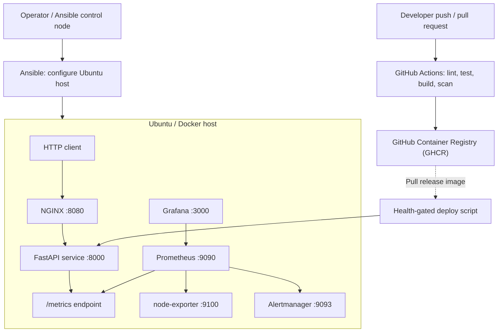

<div align="center">

# ☁️ CloudOps
### Automated Infrastructure Deployment & Observability Platform

**From source code to a monitored containerized service — with infrastructure automation, CI/CD, health checks, alerting, and release rollback.**

[](https://github.com/ZubairYousuf/Automated-Infrastructure-Deployment-Observability-Platform/actions/workflows/ci.yml)
[](https://github.com/ZubairYousuf/Automated-Infrastructure-Deployment-Observability-Platform/actions/workflows/publish.yml)


**[Quick Start](#-quick-start) · [Architecture](#-architecture) · [Monitoring](#-observability--alerting) · [CI/CD](#-continuous-integration--delivery) · [Deployment](#-deployment--rollback) · [Documentation](#-documentation)**

</div>

---

## 🎯 The idea

Shipping an application is more than writing code. A reliable delivery workflow needs a reproducible build, a secure runtime baseline, a reverse proxy, deployment automation, visibility into failures, and a recovery path when a release goes wrong.

**CloudOps** brings these concerns together in a compact, single-host DevOps engineering lab. It is designed to demonstrate how the individual tools connect, not merely how to install them.

| Challenge | Implementation |
| --- | --- |
| “Works on my machine” | Reproducible Python application image and Docker Compose stack |
| Manual application delivery | GitHub Actions test/build workflow and GHCR image publishing |
| Repeated server setup | Ansible playbook for an Ubuntu deployment host |
| Direct exposure of the application | NGINX as the public-facing reverse proxy |
| Limited operational visibility | Prometheus scraping, node-exporter, Grafana dashboards |
| Missed failure signals | Prometheus alert rules routed to Alertmanager |
| Risky application updates | Readiness-gated deployment script with rollback on failure |
| Difficult handover | Architecture notes, deployment guide, security notes, and runbook |

> **Project status:** The source and infrastructure configuration are provided as a portfolio/reference implementation. The badges above report GitHub Actions status; they are not a claim of production availability. Run the stack and verify CI and deployment behavior in your own environment before claiming operational results.

## 🏗️ Architecture



**Two paths work together:**

1. **Delivery:** a commit triggers validation and image-building workflows. The publishing workflow can push tagged images to GHCR. Ansible prepares a target machine, and the deployment script switches application images after checking readiness.
2. **Operations:** NGINX forwards requests to the API; Prometheus collects API and host metrics; Grafana visualizes them; alert rules describe conditions that warrant investigation.

The diagram is a logical overview. The monitoring endpoints are bound to loopback on the Docker host by default, while the NGINX demo endpoint is exposed on port `8080`.

## 🧰 Technology stack

| Layer | Technology | Responsibility |
| --- | --- | --- |
| Application | Python 3.12, FastAPI, Uvicorn | Small HTTP service with demo task endpoints |
| Containerization | Docker, Docker Compose | Application and monitoring services |
| Edge | NGINX | Reverse proxy and request forwarding |
| CI | GitHub Actions, pytest, Ruff | Automated quality checks and image build |
| Registry | GitHub Container Registry | Publish container images |
| Infrastructure automation | Ansible | Prepare Ubuntu host and service configuration |
| Metrics | Prometheus, prometheus-client | Application and infrastructure time series |
| Host telemetry | node-exporter | Host CPU and memory metrics |
| Visualization | Grafana | Provisioned datasource and dashboard |
| Alert routing | Alertmanager | Receives alerts; external notifications require configuration |
| Release control | Bash | Health-gated image update and rollback |

## ✨ Features

### 01 · Instrumented application

The included FastAPI service is intentionally small, so the focus remains on delivery and operations.

- Liveness and readiness endpoints for health checks.
- Task creation and listing endpoints for exercising API behavior.
- Prometheus request counter and latency histogram.
- OpenAPI documentation provided by FastAPI.
- Automated tests for health, validation, task operations, and metrics.

**API endpoints**

| Method | Path | Purpose |
| --- | --- | --- |
| GET | `/` | Service information |
| GET | `/health/live` | Liveness probe |
| GET | `/health/ready` | Readiness probe |
| POST | `/api/v1/tasks` | Create a demo task |
| GET | `/api/v1/tasks` | List demo tasks |
| GET | `/api/v1/tasks/{task_id}` | Retrieve one task |
| GET | `/metrics` | Prometheus exposition (internal; blocked at NGINX) |

**Note:** Task storage is in-memory and is reset when the process restarts. The demo API does not include user authentication or a persistent database.

### 02 · Containerized service stack

The Compose definition brings together **six services**: API, NGINX, Prometheus, node-exporter, Grafana, and Alertmanager.

The API container uses a non-root user, read-only filesystem, dropped Linux capabilities, resource limits, and an HTTP health check. Monitoring data uses Docker volumes for persistence.

### 03 · CI and image publishing

The `ci.yml` workflow includes Python dependency installation, linting, unit tests, Docker image build, container smoke test, and a Trivy filesystem scan. The `publish.yml` workflow authenticates to GHCR using GitHub's workflow token and publishes tagged images.

The workflows are separate on purpose: validation and publishing are distinct responsibilities. Check the **Actions** tab for actual results; a workflow file existing does not guarantee a successful run.

### 04 · Infrastructure as code

The Ansible playbook describes the baseline setup for an Ubuntu VM, including Docker packages, a deployment directory, configuration files, environment templating, and Compose startup.

It is a starting point for controlled VM deployments, not a universal production provisioning solution. Read the [deployment guide](docs/deployment.md) before using it on a real server.

### 05 · Observability and alerting

Prometheus collects application and host metrics. The provisioned Grafana dashboard includes panels for:

- Request throughput.
- p95 HTTP request latency.
- API scrape availability.
- Host memory utilization.
- HTTP 5xx response rate.
- Host CPU utilization.

Alert rules cover API scrape failures, elevated 5xx ratios, and high host memory usage. Alertmanager is included with a placeholder receiver; **email, Slack, and other real notification destinations are not enabled by default**.

### 06 · Health-gated rollback

The deployment script takes a new image reference, saves the current environment configuration, pulls the requested image, restarts the API container, and checks readiness. If readiness never succeeds, it attempts to restore the previous image.

This is a **single-host rollback mechanism**, not a zero-downtime blue/green or Kubernetes rollout. Test recovery on a disposable VM before relying on it.

---

## 🚀 Quick start

### Prerequisites

- Docker Engine with Docker Compose v2.
- Git.
- A machine with enough memory to run the application and monitoring containers.
- Ports `8080`, `3000`, `9090`, and `9093` available as configured.

### 1. Clone the repository

```bash
git clone https://github.com/ZubairYousuf/Automated-Infrastructure-Deployment-Observability-Platform.git
cd Automated-Infrastructure-Deployment-Observability-Platform
```

### 2. Configure your environment

```bash
cp .env.example .env
```

Edit `.env` and set `GRAFANA_ADMIN_PASSWORD` to a **unique, strong password**. Do not commit the file.

### 3. Build and start the stack

```bash
docker compose up --build -d
docker compose ps
```

### 4. Verify the API

```bash
curl -f http://localhost:8080/health/ready
curl http://localhost:8080/
```

Example readiness response:

```json
{"status":"ready"}
```

### 5. Exercise the demo endpoint

```bash
curl -X POST http://localhost:8080/api/v1/tasks \
  -H "Content-Type: application/json" \
  -d '{"title":"Validate monitoring pipeline"}'

curl http://localhost:8080/api/v1/tasks
```

### 6. Explore the dashboards

| Service | URL | Notes |
| --- | --- | --- |
| Application | http://localhost:8080 | Public-facing local demo |
| API documentation | http://localhost:8080/docs | FastAPI Swagger UI |
| Grafana | http://127.0.0.1:3000 | Login: `admin` + password from `.env` |
| Prometheus | http://127.0.0.1:9090 | Targets, metrics, and alert rules |
| Alertmanager | http://127.0.0.1:9093 | Alert routing UI |

Generate a little sample traffic to populate request-rate graphs:

```bash
bash scripts/load-test.sh http://localhost:8080 100
```

This script sends sequential HTTP requests for a demo; it is **not** a benchmark or load-capacity measurement.

### Stop the stack

```bash
docker compose down
```

To also remove persisted Grafana and Prometheus data, use `docker compose down -v` **only if you intend to delete those volumes**.

---

## 📈 Observability & alerting

Grafana is provisioned from files committed to this repository:

- [Datasource configuration](infra/grafana/provisioning/datasources/datasource.yml)
- [Dashboard provisioning](infra/grafana/provisioning/dashboards/dashboards.yml)
- [CloudOps overview dashboard](infra/grafana/dashboards/cloudops-overview.json)

Prometheus configuration and alert definitions are also version-controlled:

- [Scrape configuration](infra/prometheus/prometheus.yml)
- [Alert rules](infra/prometheus/rules/alerts.yml)
- [Alertmanager configuration](infra/prometheus/alertmanager.yml)

**Suggested demo:** start the stack, open the dashboard, send 100 requests, then inspect the request counter and latency panels. In a disposable test environment, you can stop the API and observe the scrape target becoming unavailable and the `ApiDown` alert becoming eligible to fire after its configured delay.

> Grafana screenshots are intentionally not fabricated. Capture real screenshots after running the stack and add them to `docs/screenshots/` if you want visual proof in your portfolio.

## 🔄 Continuous integration & delivery

```text
Push / Pull Request
      |
      v
  Ruff lint + pytest
      |
      v
 Docker image build
      |
      v
 Container smoke test
      |
      v
  Trivy file scan

Main branch app changes
      |
      v
  GHCR image publish
      |
      v
  Manual / operator deployment to Ubuntu VM
      |
      v
  Readiness check -> Keep release / Attempt rollback
```

**Important distinction:** Image publishing is automated by the workflow, but remote VM deployment is **not automatically triggered by the publish workflow**. An operator must prepare the target and invoke deployment. This avoids implying an unattended production release process that is not implemented.

## 🛠️ Deployment & rollback

The Ubuntu reference playbook is located at [`infra/ansible/site.yml`](infra/ansible/site.yml). Start with the sample inventory:

```bash
cp infra/ansible/inventory.ini.example infra/ansible/inventory.ini
```

Update the inventory for your VM, install the listed Ansible collection requirements, and follow [`docs/deployment.md`](docs/deployment.md) for the full procedure and prerequisites.

The deployment script accepts an **image reference**, for example:

```bash
sudo CLOUDOPS_DIR=/opt/cloudops bash scripts/deploy.sh ghcr.io/OWNER/REPOSITORY:sha-EXAMPLE
```

Use an image that has actually been published and is accessible from the VM. The sample image tag above is illustrative.

The script is designed to keep the previous image reference in reserve until the new API passes readiness checks. Recovery still depends on the previous image being available locally or from a registry.

## 🔐 Security considerations

Security measures included in this lab:

- Non-root API runtime.
- Read-only API root filesystem and temporary writable storage.
- Container capability dropping and `no-new-privileges`.
- API CPU, memory, and process limits.
- Loopback binding for monitoring web interfaces.
- Environment-based Grafana administrator password.
- Public NGINX denial of `/metrics`.
- Git ignore rules for local secrets and inventory.

**Not included:** HTTPS termination, authentication for the demo API, a managed secrets service, high availability, persistent application data, or production-grade network segmentation. Treat the project as a learning environment and review [security notes](docs/security.md) before exposing it to the internet.

## 🧪 Testing and validation

Run the Python checks in a Python 3.12 virtual environment:

```bash
python3 -m venv .venv
source .venv/bin/activate
pip install -r app/requirements-dev.txt
ruff check app
pytest -q app/tests
```

Validate Compose after creating `.env`:

```bash
docker compose config --quiet
```

Run the complete container smoke test manually with the Quick Start instructions. For ongoing CI results, use the repository's [GitHub Actions page](https://github.com/ZubairYousuf/Automated-Infrastructure-Deployment-Observability-Platform/actions).

## 📁 Repository layout

```text
.
├── .github/
│   └── workflows/
│       ├── ci.yml                  # Lint, test, build, smoke test, scan
│       └── publish.yml             # Publish images to GHCR
├── app/
│   ├── Dockerfile                  # Non-root API image
│   ├── main.py                     # FastAPI endpoints + metrics
│   ├── requirements.txt
│   ├── requirements-dev.txt
│   └── tests/
│       └── test_api.py
├── docs/
│   ├── architecture.md
│   ├── deployment.md
│   ├── runbook.md
│   └── security.md
├── infra/
│   ├── ansible/
│   │   ├── inventory.ini.example
│   │   ├── site.yml
│   │   ├── requirements.yml
│   │   └── templates/
│   ├── grafana/
│   │   ├── dashboards/
│   │   └── provisioning/
│   ├── nginx/
│   │   └── default.conf
│   └── prometheus/
│       ├── prometheus.yml
│       ├── alertmanager.yml
│       └── rules/
├── scripts/
│   ├── deploy.sh                   # Image rollout + readiness gate
│   ├── load-test.sh                # Generate example traffic
│   └── validate.sh
├── compose.yaml
├── .env.example
├── pyproject.toml
├── LICENSE
└── README.md
```

## 📚 Documentation

| Guide | What's inside |
| --- | --- |
| [Architecture](docs/architecture.md) | Components, request flow, telemetry flow, limitations |
| [Deployment](docs/deployment.md) | Local and Ubuntu VM deployment steps |
| [Runbook](docs/runbook.md) | Common failures, diagnosis, recovery |
| [Security](docs/security.md) | Threats, safeguards, and known gaps |
| [Publishing notes](PUBLISH_TO_GITHUB.md) | Quick verification checklist |

## 🧭 Future improvements

This project is intentionally scoped as a medium-sized single-host platform. Natural next steps include:

- TLS termination and authenticated access.
- Persistent task storage with PostgreSQL and migrations.
- Real Alertmanager integrations such as email or Slack.
- A staging environment and deployment approval gates.
- Integration tests that verify rollback against an intentionally unhealthy release.
- Image signature verification, SBOMs, and pinned image digests.
- Infrastructure provisioning with Terraform.
- Multi-host or Kubernetes deployment with service-level objectives.

These are **planned extensions, not implemented features**.

## 💼 What this demonstrates

This repository is intended as evidence of hands-on familiarity with:

**Linux administration · Containerization · CI/CD · Configuration management · Reverse proxies · Metrics and dashboards · Alerting · Deployment safety · Technical documentation**

A useful interview walkthrough is to explain how a commit becomes an image, how the host is prepared, how requests reach the application, how telemetry is collected, and what happens if a new image fails readiness.

## 🤝 Contributing

Issues and pull requests are welcome. For changes, keep the scope focused, add or update tests when applicable, and verify `ruff`, `pytest`, and `docker compose config` before opening a pull request.

## 📄 License

Distributed under the [MIT License](LICENSE).

---

<div align="center">

**Built by [Zubair Yousuf](https://github.com/ZubairYousuf)**

*Build it. Ship it. Observe it. Recover it.*

[⬆ Back to top](#️-cloudops)

</div>
